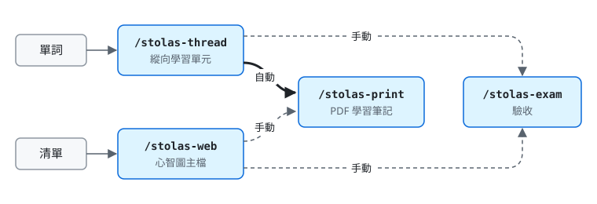

# Stolas：AI 助學 Claude Skills

Stolas 是一組幫助自學的 Claude skill。遇到看不懂的專有名詞、外文術語或古典文本時，用它把一個詞展開成完整的學習單元，或把一整串詞攤成一張關係圖，學完可以驗收，最後產出 PDF 學習筆記留著回顧。所有內容會整併成 Markdown 檔，附 Obsidian 可讀取的學科標籤。

系列共四個 skill，各自獨立安裝，彼此透過檔案銜接。

| 技能 | 版本 | 什麼時候用 | 做什麼 |
|---|---|---|---|
| [stolas-thread](stolas-thread/) | v6 | 手上只有一個詞 | 一條線：AI 先排好脈絡地圖，沿上游、本體、下游縱向展開成學習單元 |
| [stolas-web](stolas-web/) | v3 | 手上有一張詞彙表 | 一張網：依你點名逐一拆解，把詞與詞的從屬、對比、因果攤成心智圖 |
| [stolas-exam](stolas-exam/) | v2 | 已有 thread 教材或 web 主檔 | 用文字作答的題目驗收，批改後把結果寫回原檔 |
| [stolas-print](stolas-print/) | v1 | thread 教材已結案，或 web 主檔任何時候 | 產出 PDF 學習筆記 |

## 四個 skill 怎麼串在一起



粗實線為自動銜接，虛線為手動輸入指令。

- thread 說「結案」後會自動接著產出 PDF；web 要自己說「產出 PDF」或輸入 `/stolas-print`。
- 驗收一律手動，輸入 `/stolas-exam` 或說「考我」。thread 與 web 只負責講解，講過不等於學會，「已掌握」只由 exam 依作答結果判定。
- thread 學到一半發現自己一直在問同一層的詞，會建議改用 web；web 想深入某個詞時，會建議另開 thread。
- print 的內容只取自檔案本身，不依賴對話紀錄，所以可以在新對話中重產。

## 使用方式

每個 skill 都要以自己的斜線指令開頭才會啟動 (全形 `／` 也可以)。單打 `/stolas` 不會觸發任何一個。

**stolas-thread**

- `/stolas-thread Semaglutide`
- `/stolas-thread 杜甫〈登高〉`
- `/stolas-thread 我感覺台灣飲料店小品牌很多，為什麼沒有寡占` (先查核觀察對不對，再對應到可教的專有名詞)
- `/stolas-thread` 附上一張圖片，詢問「這是什麼」

單元開始後可以直接追問，或說「繼續教學」「沒聽懂」「生成全教材」「結案」。

**stolas-web**

- `/stolas-web 智慧電網`
- `/stolas-web 半導體先進封裝` (可另附相關文件或詞彙表)

之後直接丟關鍵字、一整串詞彙表，或「X 下的 Y」「Y 跟 X 比」這類關係描述。說「看目錄樹」可以看目前整張網。

**stolas-exam**

- `/stolas-exam`：考最近一份教材或主檔
- `/stolas-exam 不飽和脂肪`、`/stolas-exam K3 這一支`：指定主題或範圍

在用過 thread 或 web 的對話中，說「驗收」「考我」「跳至結尾驗收」也會啟動。

**stolas-print**

- thread 單元說「結案」後會自動接著產出 PDF
- web 工作階段中說「產出 PDF」，或輸入 `/stolas-print`
- 新對話中輸入 `/stolas-print <主題>` 或附上檔案重產

## 安裝

到 [Releases](https://github.com/AG-0814/Stolas_ClaudeSkills/releases) 下載各 skill 最新版的 `.skill` 檔：

- **claude.ai**：在設定的技能 (Skills) 頁面上傳 `.skill` 檔。四個建議都裝，至少要裝 stolas-print 才能產出 PDF。
- **Claude Code**：把對應的資料夾 (例如 `stolas-thread/`) 複製到 `~/.claude/skills/` 底下。

## 環境需求

- 需要開啟程式執行 (Code Execution) 功能，教材檔、主檔與 PDF 才能產生。
- 有網路搜尋工具時，涉及數據、法規、時效資訊的內容會先查證再寫入。
- stolas-print 會使用 pandoc、Playwright (Chromium)、mermaid-cli 與 pypdf；缺少其中幾項時，腳本會自動降級處理，全部失敗時交付 HTML。

## 檔案結構

```
Stolas_ClaudeSkills/
├── README.md
├── LICENSE
├── stolas-thread/      SKILL.md、README.md、references/
├── stolas-web/         SKILL.md、README.md
├── stolas-exam/        SKILL.md、README.md、references/
└── stolas-print/       SKILL.md、README.md、assets/、references/、scripts/
```

各資料夾的詳細結構與用法，見各自的 README。

## 版本沿革

- **stolas v1 到 v4**：單一 skill，涵蓋學前診斷、脈絡地圖、教材、期中與最終驗收、結案 PDF。v4 仍可在 [Releases](https://github.com/AG-0814/Stolas_ClaudeSkills/releases/tag/v4) 下載。
- **2026-10 拆分**：原本的 stolas 改名 stolas-thread (v5 起)，輕量版 stolas-lite 改名 stolas-web，驗收拆成 stolas-exam，PDF 產出拆成 stolas-print。舊版的 stolas、stolas-lite 檔案，exam 與 print 都認得。

## 致謝

Stolas 系列自第三版起的部分設計概念，參考自 Matt Pocock 的 [mattpocock/skills](https://github.com/mattpocock/skills) 倉庫 (MIT License)，主要是 `skills/productivity/` 中的 teach、wait-what、to-questionnaire 與 writing-for-agents。參考的範圍包括：以術語表作為已定義清單並統一用語、以作答證據判定掌握、誤解只收錄被更正過的錯誤、課程與參考資料分離、沒聽懂時換方式重講，以及撰寫 skill 時的正向描述、漸進揭露與單一規則來源等原則。

以上皆為概念參考，Stolas 系列的所有文字與程式均為重新撰寫，未複製原倉庫的內容。感謝原作者公開分享。

## 貢獻者

- [AG-0814](https://github.com/AG-0814)：作者
- [Claude](https://claude.com/claude-code) (Anthropic)：協作撰寫與維護

## 授權

本專案以 MIT License 釋出，詳見 [LICENSE](LICENSE)。
