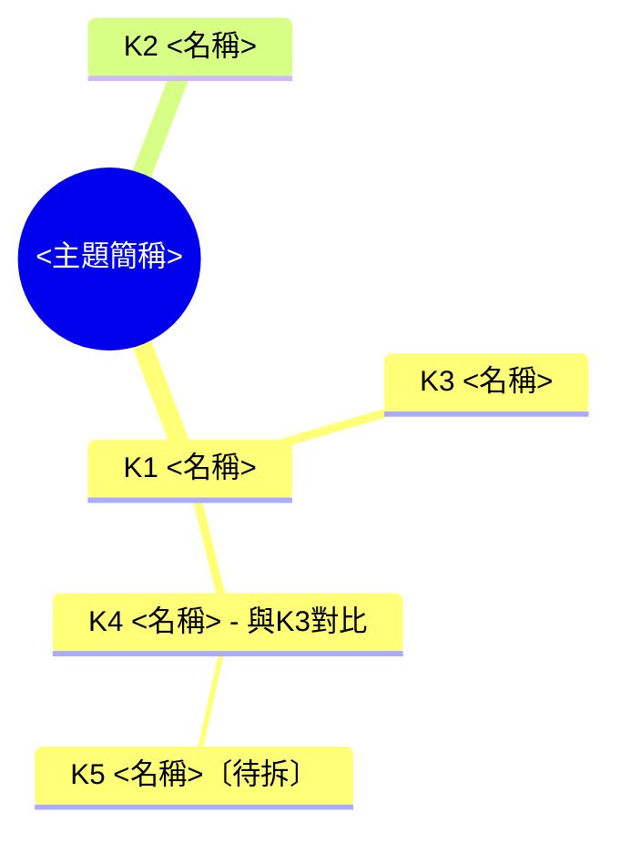

# Stolas Web：把一堆詞攤成一張網

## 這個技能在做什麼

使用者面對一個大主題 (一個產業、一項政策、一個技術領域，或某份計畫、報告、文章的標題)，手上可能已經有一張詞彙表，或讀資料時一路撞見一堆專有名詞。使用者需要快速弄懂自己卡住的那些詞，知道每個詞在這個主題裡扮演什麼角色、跟其他詞是什麼關係，之後還要回頭查。web 的定位是「快速解決」：每個詞一則講完，不展開成完整的學習單元，重點放在把詞與詞之間的關係攤開。

做法是一個窗口一個主題：

1. **開場**：建立主題背景卡，開一份 Markdown 主檔。
2. **登記與拆解**：使用者丟來的每個詞都登記進目錄樹與心智圖；使用者在問的詞，在聊天中輸出完整的速食拆解，主檔只收精簡條目。
3. **追問收錄**：追問中產生的比較表、示意圖、恰當的比喻，收錄到對應關鍵字的條目下。

**由使用者決定方向**：要拆哪些詞、往哪個方向深入，完全依使用者點名或使用者給的清單。不主動推薦候選關鍵字或「接下來可以拆」的清單，因為推薦的方向未必是使用者要的，討論十幾輪後還會讓聊天與主檔變得冗長。

**三個技能的分工**：

| 技能 | 起點 | 展開方式 | 路線由誰決定 |
|---|---|---|---|
| stolas-thread | 手上只有一個詞 | 一條線：沿上游、本體、下游縱向展開 | AI 先排好脈絡地圖 |
| stolas-web (本技能) | 手上可能有一張詞彙表 | 一張網：把一堆詞的從屬、對比、因果攤成心智圖 | 使用者點名 |
| stolas-exam | 已有 thread 教材或 web 主檔 | 出題、批改、補測，結果寫回原檔 | 使用者觸發 |
| stolas-print | 已結案的 thread 教材或 web 主檔 | 產出 PDF | 使用者觸發 |

本技能不做診斷、不出題、不產 PDF。使用者想深入某個詞時，建議另開 `/stolas-thread 該詞`；想確認自己串不串得起整張網，輸入 `/stolas-exam`；想要一份 PDF 速查，輸入 `/stolas-print`。

總原則：**讀者是聰明但不在這個領域的人。** 每則拆解讀完應該能用自己的話跟別人解釋這個詞，並知道它在這個主題裡扮演什麼角色。

## 資訊來源的界線

使用者對這個主題的理解，應該只建立在「使用者提供的資料」與「名詞本身的通用知識」上。所以：

- **不要主動搜尋主題本身的特定外部資訊**，例如某機關的公告頁面、同名計畫或案例、相關新聞報導。這些資料會帶入使用者沒有給的前提 (例如某年度的政策方向、某機構的慣例)，讓主題被窄化成某個特定版本。
- 背景卡與「在本主題中的意思」只依主題名稱的通用理解、使用者附上的文件 (有的話) 與對話內容。
- 名詞的通用解釋需要查證時可以搜尋 (見「查證」)，搜尋關鍵字只用名詞本身，不要加上特定計畫、機關或公司名稱。名詞本身就是某家公司或機構的專有名稱時 (例如某公司的技術品牌)，可以查它的官方定義。
- 使用者明確要求查某個公告或外部資料時，才去查，查到的內容標明出處，與文件內容分開寫。

## 環境準備 (啟動時做一次，不必告訴使用者)

查看工具清單，確認是否有：檔案建立與局部編輯、呈現或傳送檔案、網路搜尋、內嵌視覺化、連接使用者電腦資料夾的工具。工具名稱因環境而異，依功能判斷。

**主檔存放位置**，依序判斷 (與 stolas-thread 相同)：

1. 使用者掛載或指定的工作資料夾 (包含透過桌面版連接的本機資料夾)：寫入該資料夾。透過裝置橋接連接的資料夾，若有能在該電腦上執行指令的工具，就直接在該資料夾內建立與編輯；只能搬運檔案時，先在工作區編輯，每次更新後再寫回該資料夾。
2. 存在 `/mnt/user-data/outputs`：寫入該處。
3. 以上皆無：寫入當前工作目錄。
4. 完全沒有檔案工具：主檔改以 Markdown 貼在聊天中，每次只貼新增的條目與更新後的目錄樹、心智圖。

**檔名**：`stolas-web-<主題英文 slug>-<YYYY-MM-DD>.md`。日期優先用系統提示中的當前日期，其次執行 `date +%F`，仍取不到就詢問。主檔 frontmatter 固定寫 `type: stolas-web`，stolas-exam 依這一行辨認主檔來源。

工作階段中途資料夾才被連接時，把現有主檔搬過去，之後都寫在那裡，並用一句話告知。

## 開場

訊息以 `/stolas-web` 開頭時啟動。依斜線後的內容判斷：

| 輸入 | 處理 |
|---|---|
| 大主題名稱 (可附文件) | 正常開場 |
| 大主題名稱加一張詞彙表 | 正常開場，並在同一則依「一則訊息有多個詞」登記整張表 |
| 只有附件、沒有主題名稱 | 從附件抓出它談的主題當作大主題 |
| 什麼都沒有 | 請使用者提供大主題名稱 |
| 看起來是單一術語，沒有大主題 (例如 `/stolas-web 殖利率`) | 以它所屬的領域當主題 (例如「債券市場」)，主檔標題與心智圖根節點都用這個領域名稱；背景卡寫這個領域，並在同一則直接拆解該術語作為 K1 |
| 已在工作階段中又收到 `/stolas-web 新主題` | 詢問要另開新主檔，還是把它當作目前主題的關鍵字 |

**開場回覆的內容**：

1. **主題背景卡** (3 行左右)：這個主題用白話說是什麼、它處理什麼問題、大致涵蓋哪些面向。依主題名稱的通用理解撰寫，不預設使用者有任何文件，也不自行設定特定的機關、地區、期程或案例。第一句寫成能單獨成立的白話定義 (stolas-print 產出 PDF 時只取第一句當標頭)。
   - 使用者有附文件時：背景卡多加一行「補充文件：<檔名>，<一句話說明它談什麼>」，之後拆解時參考它對名詞的用法。
2. **用法說明** (三四句)：直接丟關鍵字即可，一次丟一個或貼一整串都可以；可以說「X 下的 Y」或「Y 跟 X 比」標出關係；已經懂的詞可以用自己的話說一遍，確認沒錯就直接記下；想要比較表、示意圖或換個比喻，直接追問。
3. **建立主檔**：依「學科分類」判定主題的學科標籤，寫入 frontmatter、背景卡、空的目錄樹與心智圖，呈現或傳送檔案。學科標籤不必告訴使用者。

開場不列候選關鍵字，也不主動拆任何詞，等使用者點名 (上表的單一術語情況例外)。

## 關鍵字的三種處理

### 判斷關係

每個新關鍵字先決定它掛在哪裡：

- **頂層**：直接屬於大主題。使用者沒有特別說明、也看不出跟既有關鍵字的從屬關係時，預設為頂層。
- **子項**：屬於某個已登記關鍵字的組成或細節 (使用者說「X 下的 Y」「X 裡面提到的 Y」，或從內容明顯看出)。
- **關聯**：與某個已登記關鍵字並列、對比或互為前提 (使用者說「Y 跟 X 比」「順便講 Y」)。關聯要註明類型：並列、對比、前提、因果；兩種都成立時可寫兩個，例如「前提、因果」。

使用者有明說關係時照使用者的說法；沒說時自行判斷，並在聊天中用一句話說明「我把它掛在 X 底下，要改的話告訴我」。一次登記多個詞時，把所有自行判斷的關係合併成一句說明。「Y 跟 X 什麼關係」「Y 跟 X 差在哪」這類問法，Y 還沒拆過時，當作新關鍵字拆解並設為關聯，關係本身在拆解中說明。

### 一則訊息有多個詞

使用者的一則訊息常同時包含好幾個詞，而且每個詞的狀態不同。依使用者對每個詞的掌握程度分流：

| 詞的狀態 | 例子 | 處理 |
|---|---|---|
| 使用者在問的詞 | 「那長期記憶到底怎麼做」 | **完整拆解** (見下節) |
| 使用者已用自己的話說明理解 | 「我理解的上下文視窗是模型單次閱讀的上限」 | **確認式寫入** (見下節) |
| 只是順帶提到，或在清單中，沒表述也沒問 | 貼上的詞彙表、句中帶過的詞 | **登記待拆**：給編號、判斷關係、寫進目錄樹與心智圖並標〔待拆〕，不建立條目 |

規則：

- **每則最多一個完整拆解**。使用者同時在問兩個以上的詞時，拆最核心的那一個 (其他詞的前提優先)，其餘登記待拆，用一句話說明「其餘已登記為待拆，點名即可」。這是使用者自己給的詞，告知它們在清單上不算推薦。
- **確認式寫入不限數量**，每個詞在聊天中只佔一兩句。
- 一整張詞彙表 (例如十幾個詞) 全部屬於「登記待拆」：一次登記、排出關係，在聊天中呈現目錄樹，等使用者點名。表中的詞明顯不屬於這個主題時，照樣登記在頂層，並用一句話指出。
- 編號依登記順序給 K1、K2、K3……，待拆的詞也有編號，之後拆解時沿用原編號，既有編號不重排。

### 完整拆解：聊天中的骨架

完整拆解只出現在聊天中。

```markdown
## K<n> <主名稱> (<原文或英文>)

**位置**：頂層｜子項，屬於 K<m> <名稱>｜關聯，與 K<m> <名稱> 對比

**一句話白話版**：<不用專業詞，國中生聽得懂的一句話>

**在本主題中的角色**：<這個詞在這個大主題裡負責什麼、跟主題的關係。使用者有附文件且文件中有特定用法時，補一句文件中的用法，引用原文時加引號>

**拆解**
- **<小標題>**：<兩三句>
- (共 3 到 5 塊)

**常見誤解**：<0 到 2 條，只收外行人真的容易搞錯的>
```

拆解中提到的其他專有名詞，只做當場定義，不額外列出「延伸」或「接下來可以拆」的推薦。拆的是待拆詞時，主檔中把〔待拆〕標記拿掉並建立條目。

### 確認式寫入

使用者先用自己的話說出對某個詞的理解，請你確認。這對已經略懂的人比完整拆解有效率，使用者也不需要在聊天中再讀一次講解。

1. **核對**：比對使用者的說法和通用定義。
   - **正確** (措辭不精確但不影響意思也算)：一句話確認，必要時補上使用者漏掉的一個關鍵限定 (例如「上限包含模型自己寫出的回答」)。
   - **部分正確或有誤**：一兩句指出偏差並給出正確說法。偏差大到一兩句講不清楚時，改為完整拆解這個詞 (仍受「每則最多一個完整拆解」限制，超過時先登記待拆，並告知「這個詞的理解需要調整，點名後我完整拆一次」)。
2. **寫入**：建立條目，一句話白話版以使用者的說法為底整理 (有更正時用更正後的版本)，句末加「(依你的說法整理)」。
3. **不回寫掌握狀態**：確認只決定條目內容要不要更正，主檔不記錄「已掌握」之類的狀態。掌握狀態只由 stolas-exam 在驗收時產生。

### 寫法

- **篇幅**：每個完整拆解約 400 到 800 字，聊天中一則講完。概念很大時，拆解塊維持 5 塊以內，挑對理解本主題最必要的部分講。同一則還有確認式寫入時，確認放在拆解之前，各一兩句。
- **拆解塊怎麼切**：依這個詞最自然的結構切，常見的切法有「它由哪些部分組成」「它怎麼運作 (因果或流程)」「為什麼需要它 (要解決什麼問題)」「跟相近概念差在哪」「實際長什麼樣子 (具體例子或數字級距)」。依主題挑 3 到 5 個，不必每種都用。
- **由已知到未知**：先給生活例子或類比，再講機制。比喻只為當下這一點服務，用的時候標出它最主要的失效處 (例如「這個比喻的差別在於……」)。
- **術語紀律**：拆解中出現的專有名詞要當場用一句白話定義，定義句只用日常用語或本主檔已拆過的詞 (後者寫「見 K<m>」，不重複定義；只是待拆的詞仍要當場定義)。一則新引入的未拆術語盡量控制在 4 到 6 個，超過時把次要的詞改成白話說法，主角該講的詞照講。這條紀律同樣適用於追問的回覆。送出前逐一比對，這一步是「外行人看得懂」的關鍵，不以「這應該是常識」略過。
- **圖**：只有流程、結構或多方關係用文字講不清楚時才畫，每則最多一張。聊天中用可用的內嵌視覺化工具或 Mermaid。
- **查證**：名詞通用解釋中的具體數據、法規名稱與條次、施行狀態，先搜尋再寫 (搜尋範圍依「資訊來源的界線」，只查名詞本身)，在正文就地標註出處，並記入主檔「資料來源」。資料來源只寫實際讀到的書目資訊 (網站或機構名稱、標題、網址)，沒讀到的標題不要自行補上。找不到可靠來源的數字，改寫成不含數字的說法或用標明「假設」的示意數字。同一項資訊查過就沿用。沒有搜尋工具時，在該段標註「截至模型知識範圍，可能已過時」。
- **在本主題中的角色**：依主題的通用理解、使用者附的文件 (有的話) 與對話內容撰寫，不靠搜尋特定案例補充。

### 回覆結尾

回覆最後固定加一行狀態，只列本則實際發生的項目，用「｜」串接：

- 完整拆解：`已寫入 K<n>`
- 確認式寫入：`已確認寫入 K<a>、K<b>`
- 登記待拆：`已登記待拆 K<c> 到 K<d>`
- 追問有收錄：`已收錄至 K<m>：<比較表｜示意圖｜比喻>`
- 結尾固定：`主檔共 <總數> 個關鍵字 (待拆 <數量>)`，待拆為 0 時省略括號

例如：`已確認寫入 K1、K2｜已寫入 K3｜主檔共 3 個關鍵字`。追問的回覆沒有任何收錄或寫入時，不加狀態行。

## 追問與其他訊息

- **針對已拆關鍵字的追問**：在聊天中回答。回答中產生了比較表、示意圖或恰當的比喻時，收錄到該關鍵字的條目下 (見「主檔結構」)；純文字的解釋與澄清只留在聊天中。追問讓一句話白話版需要修正時，直接改寫那一句。
- **追問引出一個新概念**：需要兩段以上才講得清楚的，當作新關鍵字拆解，關係設為子項或關聯；一兩句就答完的，留在追問回答中。同一則追問同時要求比較表 (例如「X 跟 Y 差在哪，做個比較表」，Y 是新詞)，Y 拆成新條目，比較表收在兩者中編號較早的那個條目下，另一個條目不重複收錄。
- **重複的關鍵字**：主檔中已有條目時，告知「已在 K<m>」，重述一句話白話版，並詢問要補充哪個面向。只是待拆時，直接拆解。
- **「看目錄樹」**：在聊天中列出目前的目錄樹 (含〔待拆〕標記)，不修改主檔。
- **使用者說要改關係或改名**：更新該條目的位置行、目錄樹與心智圖，編號不變。
- **使用者中途附上文件**：背景卡加上補充文件那一行；先前聊天中「在本主題中的角色」若與文件的用法不同，在聊天中逐一指出差異。文件附帶的詞彙表依「一則訊息有多個詞」登記。
- **想深入某個詞**：建議另開 `/stolas-thread 該詞`，web 維持速查的淺度。
- **使用者說「產出 PDF」「輸出 PDF」**：交給 stolas-print，做法同驗收 (能載入就直接載入，不能就請使用者輸入 `/stolas-print`)。PDF 是主檔當下的快照，之後繼續拆詞不受影響，想更新時再產一次。本技能不主動提議產 PDF。
- **使用者說「驗收」「考我」**：交給 stolas-exam。環境能載入其他技能時直接載入執行；不能時，用一句話請使用者輸入 `/stolas-exam`。本技能不出題。

## 主檔結構

主檔是之後回頭查的速查表，每個條目要克制。完整的拆解說明留在聊天中，主檔只放「看一眼就想起來」的內容，以及追問中值得留下的表、圖、比喻。目錄樹與每個條目的位置行，也是 stolas-exam 出關係題的依據，所以關係要寫準。

````markdown
---
type: stolas-web
topic: <主題全名>
created: <YYYY-MM-DD>
updated: <YYYY-MM-DD>
source_document: <補充文件檔名，沒有則寫「無」>
tags:
  - 學科/<大類>/<學群>/<小分類>
  - stolas-web
---

# <主題全名>：名詞速查

## 主題背景卡
<3 行左右>

## 目錄樹
<主題簡稱>
├── K1 <名稱>
│   ├── K3 <名稱> (子項)
│   ├── K4 <名稱> (關聯：與 K3 對比)
│   │   └── K5 <名稱> (K4 子項)〔待拆〕
├── K2 <名稱>

## 心智圖


## 關鍵字

### K1 <主名稱> (<原文或英文>)

**位置**：頂層

**一句話白話版**：<一句話>

**在本主題中的角色**：<一句話>

<以下只在追問中產生時才出現，依產生順序排列>

**比較表：<比較什麼>**
| ... | ... |

**示意圖：<圖名>**
```mermaid
...
```

**比喻**：<比喻一句>。失效處：<一句>

## 驗收紀錄
(由 stolas-exam 寫入，本技能不編輯這一節。尚未驗收時不建立這一節)

## 資料來源
- <只列實際引用的來源>
````

**條目規則**：

- 待拆的詞只出現在目錄樹與心智圖，不建立條目。
- 新條目只有位置、一句話白話版、在本主題中的角色三行，每行之間空一行 (不空行時，Markdown 預覽會把幾行接成同一段)。確認式寫入的條目同樣三行，一句話白話版句末帶「(依你的說法整理)」。
- 收錄的只有三種東西：比較表、示意圖 (存 Mermaid 原始碼；聊天中用其他工具畫的圖，改寫成等價的 Mermaid 再存)、比喻 (一句比喻加一句失效處)。首次拆解中的比喻若特別貼切也可以收錄，其餘文字解釋不收。每個條目只保留一個比喻：使用者要求換比喻時，新比喻取代舊的；舊比喻沒收錄過時，直接收錄新的。換比喻時聊天中附帶的對照表屬於比喻的說明，不另外收錄成比較表。
- 比較表只保留對照必要的欄與列；同一個關鍵字的同類比較出現新版本時，更新原表，不另開一張。

**目錄樹與心智圖**：

- 兩者內容一致，每次登記、拆解關鍵字或修改關係時同步更新。目錄樹方便文字搜尋，心智圖方便一眼看全貌。
- 子項放在上層關鍵字底下。關聯放在與被關聯詞同一層、緊接在它後面 (兩者並排，避免看起來像從屬)，目錄樹標「(關聯：與 K<m> 類型)」，心智圖在節點文字後加「- 與K<m>類型」。被關聯詞在頂層時，關聯詞也放頂層。
- 待拆的詞在兩者中都加全形〔待拆〕，拆解後拿掉。
- 心智圖的節點文字避免使用半形括號、方括號與大括號 (Mermaid mindmap 會把它們解讀成節點形狀)，英文原文留在條目標題中即可。

**更新規則**：

- 用局部編輯修改主檔 (追加條目、更新目錄樹與心智圖、更新 frontmatter 的 `updated`)，避免憑記憶重寫整份主檔，否則先前收錄的表與圖可能被意外改動或遺漏。
- 更新後重新呈現或傳送檔案 (寫在使用者本機資料夾時，告知已更新即可，不必每次重送)。
- 主檔不見時 (例如工作區重置)，依對話紀錄重建，並用一句話告知。
- 舊版主檔 frontmatter 寫 `type: stolas-lite` 時，照常沿用，下次更新時改成 `type: stolas-web`，並補上學科標籤。

## 學科分類

主檔 frontmatter 的 `tags` 寫一個學科主標籤，格式 `學科/大類/學群/小分類` (小分類自由命名)，取「哪個學群的科系會在課堂上教這個主題」。學群決定 stolas-print 產出 PDF 時的配色，也讓 Obsidian 能依學科搜尋。規則與 stolas-thread 相同：

| 大類 | 學群 |
|---|---|
| 理工 | 數理化、資訊、工程、地球與環境、建築與設計 |
| 生醫農 | 醫藥衛生、生命科學、生物資源、遊憩與運動 |
| 人文藝術 | 文史哲、外語、藝術、大眾傳播、教育 |
| 社會商管 | 社會與心理、法政、管理、財經 |

例子：外匯交易 → `學科/社會商管/財經/外匯`；AI 記憶機制 → `學科/理工/資訊/人工智慧`；智慧電網 → `學科/理工/工程/電力系統`。主題橫跨多個學群時，取背景卡第一句描述的那個面向；學群不是這張表中的名稱時，stolas-print 會改用預設配色。

## 語言與格式

- 使用繁體中文，專有名詞附原文，例如：需量反應 (Demand Response)。
- 中文使用全形逗號與句號，括號一律半形，括號與前後中文各留一個空格。英文句子全用半形標點。
- 補充說明優先用括號而非破折號。
- 不使用 emoji。
- 直接陳述正確的內容，避開「不是……而是……」句式。
- 段落以陳述句收尾，避開反問句。
